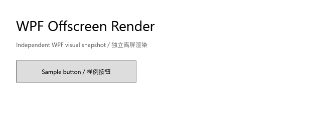
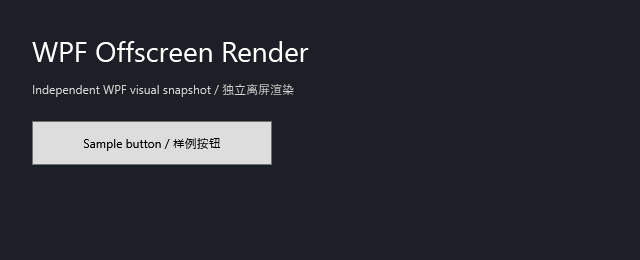
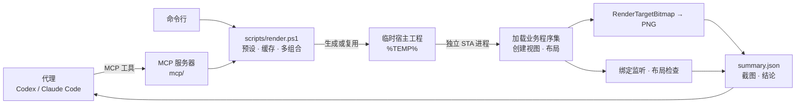

# WPF Offscreen Render

[](https://github.com/ayueryi/wpf-offscreen-render/actions/workflows/ci.yml)


让 AI 编码代理（Codex、Claude Code 等）**亲眼看到**自己改出来的 WPF 界面：在独立的临时进程里把真实的 `UserControl` / `Page` / `Window` 渲染成 PNG，并给出解析好的绑定错误和布局问题。

*Render real WPF views offscreen to PNG, with parsed binding errors and layout checks — packaged as a Claude Code / Codex plugin with an MCP server.*

| light | dark |
| --- | --- |
|  |  |

> 以上是仓库自带样例视图的真实渲染结果。

## 特点

- **真实界面**：用业务程序集里的真实控件、样式和资源渲染，不是手绘 mock；不启动业务程序，不抢焦点，不弹窗口。
- **结论可直接使用**：绑定错误解析成一行结论（如 `TextBlock.Text <- Path=CustomerNmae（数据源 OrderVm）`）；自动检查文本截断、被裁切、文本重叠、尺寸为 0、超出视口。
- **为代理设计**：内置 MCP 服务器，作为 Claude Code / Codex 插件一条命令安装；代理调用一次即可拿到截图和 JSON 摘要。
- **覆盖常见验证场景**：多主题 × 尺寸 × DPI 一次渲染并拼成总览图，修改前后像素对比，截取单个元素。
- **兼容面广**：.NET Framework 4.7.2 / 4.8 / 4.8.1 与 .NET 5 – 10，按业务程序集自动选择宿主框架与位数（含 x86）。
- **可以强制执行**：业务项目登记视图后，代理结束本轮回答前会自动渲染改动涉及的页面，有绑定错误时让代理继续修复。

**适用范围**：只能在 **Windows** 上渲染（云端 Linux 容器中的代理会话用不了）。快照不包含 `Popup` / `ToolTip`、`HwndHost`、WebView 等原生内容，也不能证明性能与交互。不适用于 WinUI、UWP、Avalonia、MAUI。

## 目录

- [安装到代理](#安装到代理)
- [代理能做什么](#代理能做什么)
- [接入业务项目](#接入业务项目)
- [命令行使用](#命令行使用)
- [工作原理](#工作原理)
- [文档](#文档)
- [开发与测试](#开发与测试)
- [安全约定](#安全约定)

## 安装到代理

**前提**：Windows 本机，已安装 PowerShell 7（`pwsh`）与 .NET 8 或更高版本的 SDK。MCP 服务器首次启动时会编译到 `%LOCALAPPDATA%\wpf-offscreen-render\mcp`，之后直接启动。冷启动的首次编译（含 NuGet 还原）可能超过客户端的 MCP 启动超时，建议安装后先预热一次：`pwsh -ExecutionPolicy Bypass -File <插件目录>\mcp\start.ps1 -BuildOnly`（Claude Code 也可以用环境变量 `MCP_TIMEOUT` 调大超时）。首次编译需要访问 NuGet；离线或内网环境的做法见 [verification.md](references/verification.md#离线与内网环境)。

### Claude Code

```text
/plugin marketplace add ayueryi/wpf-offscreen-render
/plugin install wpf-offscreen-render@wpf-offscreen-render
```

Claude Code 2.1.275 及以上也可以一步安装：`/plugin install wpf-offscreen-render --marketplace ayueryi/wpf-offscreen-render`。插件包含 skill、MCP 服务器和[结束前自动验证](#接入业务项目)的 Stop hook。

### Codex

```text
codex plugin marketplace add ayueryi/wpf-offscreen-render
```

然后在 Codex 的插件列表中安装 `wpf-offscreen-render`。

### 其他支持 MCP 的代理

把仓库克隆到固定位置（下例为 `C:\tools\wpf-offscreen-render`），在代理的 MCP 配置中添加：

```json
{
  "mcpServers": {
    "wpf-offscreen-render": {
      "command": "pwsh",
      "args": ["-NoProfile", "-NonInteractive", "-ExecutionPolicy", "Bypass", "-File", "C:\\tools\\wpf-offscreen-render\\mcp\\start.ps1"]
    }
  }
}
```

Codex 不装插件时也可以执行 `codex mcp add wpf-offscreen-render -- pwsh -NoProfile -NonInteractive -ExecutionPolicy Bypass -File C:\tools\wpf-offscreen-render\mcp\start.ps1`。需要工作流说明时，再把 `skills\wpf-offscreen-render` 复制到代理的 skills 目录（Claude Code：`.claude\skills\`；Codex：`.agents\skills\`）。

### 验证安装

让代理调用 `self_test` 工具，或者直接运行 `.\tests\run-tests.ps1 -Quick`，通过时输出 `2 通过，0 失败`。

## 代理能做什么

| MCP 工具 | 用途 |
| --- | --- |
| `render_view` | 渲染一个视图（或预设），返回 JSON 摘要和截图；传 `element` 时另附该元素的截图 |
| `render_matrix` | 一次渲染多个主题 × 尺寸 × DPI，返回汇总和总览图 |
| `compare_snapshots` | 对比两次渲染，返回变化区域和差异图（变化像素标红） |
| `get_layout` | 按元素名、文本或问题类型查询某次渲染的布局树 |
| `list_views` | 列出业务项目 `wpf-render.json` 中登记的视图 |
| `self_test` | 环境自检 |

代理拿到的摘要示例（渲染一个绑定写错了的视图）：

```json
{
  "status": "binding-issues",
  "sourceViewType": "MyUi.Views.OrderView",
  "mode": "layout-only",
  "theme": "light",
  "pixelSize": "1280x800",
  "bindingIssueCount": 1,
  "bindingIssues": [
    "TextBlock.Text <- Path=CustomerNmae（数据源 OrderPreviewVm）：BindingExpression path error: 'CustomerNmae' property not found on 'object' ''OrderPreviewVm''"
  ],
  "layoutIssueCount": 1,
  "layoutIssues": [
    "[text-truncated] TextBlock#OrderTitle「订单 #1024 · Contoso 有限公司…」：文本需要宽度 237.5，可用 180"
  ],
  "outDir": "C:\\Users\\me\\AppData\\Local\\Temp\\wpf-render-cache\\…\\render-…",
  "snapshot": "…\\snapshot.png"
}
```

`status` 为 `ok` / `binding-issues` / `failed:<阶段>`（多组合渲染的汇总为 `ok` / `binding-issues` / `failed`）。布局问题只是线索，不影响 `status`，由代理对照截图确认。完整字段见 [references/cli.md](references/cli.md)。

## 接入业务项目

不接入也能用（代理传程序集路径和视图类型即可）。接入后代理可以按名称渲染页面，并在结束前自动验证：

1. **登记视图**：把 [templates/wpf-render.json](templates/wpf-render.json) 复制到业务仓库根目录，填写程序集、视图类型、主题 / 尺寸、构建命令，以及每个视图对应的源文件（`watch`）。
2. **约定规则**：把 [templates/agent-rules.md](templates/agent-rules.md) 的内容加入业务仓库的 `AGENTS.md`（Codex）或 `CLAUDE.md`（Claude Code），要求修改界面后渲染验证并在回复中给出结论。
3. **结束前自动验证**：`wpf-render.json` 里设置 `"verifyOnStop": true`，然后在本机授权这个项目：

   ```powershell
   pwsh -ExecutionPolicy Bypass -File <插件或克隆目录>\scripts\trust-project.ps1 -Path C:\work\MyApp
   ```

   Claude Code 插件自带的 Stop hook 会在代理结束本轮前，渲染 `watch` 命中改动的视图；有渲染失败或绑定错误时阻止结束，让代理继续修复。同一份改动只验证一次。hook 会执行配置中的 `build` 命令并运行业务程序集，所以**只对授权过的项目生效**；授权记录保存在本机（不在仓库里），`wpf-render.json` 被修改后需要重新授权，未授权时 hook 只提示一次如何授权。Codex 需要按 [templates/codex-hooks.json](templates/codex-hooks.json) 自行配置（尚未在真实 Codex 中验证）。

   装了插件后，每轮结束都会启动一次 hook 进程（约 1 秒），没有 `wpf-render.json` 的项目会立即退出。

ViewModel 需要构造参数或 stub 服务时，在预设中用 `dataContextFactory` 指定一个无参静态工厂方法；还需要配置资源、等待异步加载完成时，用 `factoryFile` 指向业务仓库中的 `ViewFactory.cs`。字段说明见 [integration.md](references/integration.md#业务项目接入wpf-renderjson)。

## 命令行使用

不通过代理时，也可以直接调用 `scripts/` 下的 PowerShell 脚本（MCP 工具内部调用的就是它们）：

```powershell
git clone https://github.com/ayueryi/wpf-offscreen-render.git
cd wpf-offscreen-render
$ui = 'C:\work\MyApp\bin\Debug\net8.0-windows\MyApp.dll'   # 换成你的业务程序集

# 渲染内置样例，确认环境可用
.\scripts\render.ps1

# 渲染业务视图：TFM 与位数自动推断；同一组程序集第二次起跳过构建
$out = .\scripts\render.ps1 -AssemblyPath $ui -ViewType MyUi.Views.OrderView -DataContextType MyUi.Preview.OrderPreviewVm -Theme dark
Invoke-Item (Join-Path $out 'snapshot.png')

# 多主题 × 多尺寸，返回含 matrix.json 与 overview.png 的目录
.\scripts\render.ps1 -AssemblyPath $ui -ViewType MyUi.Views.OrderView -Theme light, dark -Size 1280x800, 800x600

# 只截某个 x:Name 元素（另存 element.png）
.\scripts\render.ps1 -AssemblyPath $ui -ViewType MyUi.Views.OrderView -Element OrderGrid

# 修改前后对比：先渲染一次作为基线，改完再渲染一次
$before = .\scripts\render.ps1 -AssemblyPath $ui -ViewType MyUi.Views.OrderView
# …修改并重新构建业务项目…
$after = .\scripts\render.ps1 -AssemblyPath $ui -ViewType MyUi.Views.OrderView
.\scripts\compare-snapshots.ps1 -Before $before -After $after

# 按业务项目的预设渲染（先执行预设中的构建命令）
.\scripts\render.ps1 -Config C:\work\MyApp -Preset OrderList -Build
```

需要一次性定制视图创建过程时，可以用两步脚本：`new-wpf-harness.ps1` 生成临时工程，修改其中的 `ViewFactory.cs`，再用 `invoke-wpf-render.ps1` 渲染。全部参数、输出文件与退出码见 [references/cli.md](references/cli.md)。

**环境要求**：

| 项目 | 要求 |
| --- | --- |
| 系统与 Shell | Windows；PowerShell 7+。`-WindowHost` 模式还需要交互式桌面会话 |
| .NET SDK | 能构建目标框架的 SDK，例如 .NET 8 / 9 / 10 SDK（也能构建 .NET Framework 目标） |
| 运行时 | .NET 宿主需要对应版本的 `Microsoft.WindowsDesktop.App`；.NET Framework 宿主需要对应版本的 .NET Framework（Windows 10 / 11 自带 4.8 / 4.8.1） |
| .NET Framework 引用程序集 | 已安装 Developer Pack，或可以访问 NuGet（SDK 会自动还原） |
| 目标程序 | .NET Framework 4.7.2 / 4.8 / 4.8.1 或 .NET 5 – 10 的 WPF；更早的 .NET Framework 程序集用 net472 宿主。不支持 .NET Core 3.x |

自查：`dotnet --list-sdks`、`dotnet --list-runtimes | Select-String WindowsDesktop`、`$PSVersionTable.PSVersion`。

## 工作原理



每次渲染都在一个新的临时进程中完成：

1. 按业务程序集推断目标框架与位数，生成（或复用缓存的）宿主工程。
2. 在 STA 线程中创建 `Application`，挂上绑定监听，并用一条故意写错的绑定自检，确认监听确实有效。
3. 创建视图（类型名、松散 XAML、静态工厂或自定义 `ViewFactory.cs`），按模式完成布局：默认直接 Measure / Arrange；`-WindowHost` 时放进屏幕外、不激活、不显示在任务栏的窗口。
4. 等待视图就绪后用 `RenderTargetBitmap` 输出 PNG，遍历视觉树做布局检查，汇总成 `summary.json`。

<details>
<summary>宿主内部细节</summary>

- `Application` 使用 `ShutdownMode.OnExplicitShutdown`，所有工作在 Dispatcher 消息循环中异步执行，`await` 不阻塞 UI 线程。
- 绑定监听：`PresentationTraceSources.DataBindingSource` 级别设为 `Warning` 并挂自定义 `TraceListener`；自检探针绑定到唯一标记路径 `WpfRenderSelfCheck_<GUID>`，只过滤这一条，其余告警全部记录。
- `window-host` 模式：窗口位于 `(-20000, -20000)`，`ShowActivated=false`、`ShowInTaskbar=false`、`WindowStyle=None`、`ResizeMode=NoResize`，截取 `Window.Content`。
- `ViewFactory.WaitUntilReadyAsync` 返回后再执行一轮 `ContextIdle` + `UpdateLayout`，然后渲染 `ceil(W×DPI/96) × ceil(H×DPI/96)` 像素的位图。
- 产物：`snapshot.png`、`manifest.json`、`layout.json`、`binding-errors.txt` / `.json`、`summary.json`，以及构建与渲染日志。
- 执行器只对自己启动的渲染子进程设置超时（默认 120 秒），只关闭自己创建的窗口。

</details>

## 文档

| 文档 | 内容 |
| --- | --- |
| [SKILL.md](skills/wpf-offscreen-render/SKILL.md) | 代理工作流：何时用、怎么调用、如何读结果与报告 |
| [references/cli.md](references/cli.md) | 全部脚本参数、渲染模式、输出文件与字段、退出码、尺寸与 DPI |
| [references/integration.md](references/integration.md) | 接入业务界面：`wpf-render.json`、程序集与框架推断、DataContext 与 `ViewFactory.cs`、资源与主题、异步就绪 |
| [references/verification.md](references/verification.md) | 产物验收、布局检查解读、视觉基线比较、故障定位、已知限制、性能验证边界 |
| [CHANGELOG.md](CHANGELOG.md) | 版本记录 |

## 开发与测试

```powershell
.\tests\run-tests.ps1                    # 全部端到端用例（需要 .NET 8 与 .NET 10 SDK）
.\tests\run-tests.ps1 -Quick             # 只跑内置样例与松散 XAML
.\tests\run-tests.ps1 -Filter 'net472*'  # 按名称筛选；-KeepArtifacts 保留产物
.\tests\validate-plugins.ps1             # 插件清单、版本号与 skill 链接一致性
dotnet run --project mcp/WpfRenderMcp.Tests -- --root .   # MCP 客户端测试（非 Windows 上只测协议）
```

CI 在 Windows 上运行全部端到端用例（含 MCP），在 Linux 上运行 MCP 协议测试、插件清单检查与 `claude plugin validate --strict`。

修改行为时同步更新 `SKILL.md`、`references/` 与本 README；`SKILL.md` 的 `description` 决定代理何时加载此 skill。发布新版本时同时修改 `VERSION`、两份插件清单与 `mcp/WpfRenderMcp/WpfRenderMcp.csproj` 中的版本号，并更新 `CHANGELOG.md`。

<details>
<summary>测试覆盖</summary>

| 覆盖范围 | 用例 |
| --- | --- |
| 渲染模式、主题、DPI、衬底 | `sample-light`、`sample-dark-dpi144`、`sample-window-host`、`sample-transparent` |
| 免代码接入 | `xaml-ok`、`net8-view`、`net472-view` |
| 绑定错误检出与解析 | `xaml-binding-error`、`net8-broken-binding`、`net472-broken-binding` |
| 布局检查：五类问题全部检出、正常布局零误报 | `net8-layout-problems`、`net472-layout-problems`、`net8-scroll-no-false-positive` |
| 缓存、多组合、元素截图、前后对比 | `render-cache`、`render-matrix`、`net8-element`、`net8-element-missing`、`compare-snapshots` |
| DataContext 工厂与预设 | `factory-method`、`factory-file`、`preset` |
| MCP 服务器与 Stop hook | `mcp-server`、`stop-hook` |
| 框架 / 位数推断与拒绝 | `net472-x86-view`、`sample-net10`、`reject-mixed-runtimes`、`reject-lower-tfm`、`reject-platform-conflict` |

</details>

<details>
<summary>仓库结构</summary>

```text
wpf-offscreen-render/
├── .claude-plugin/               # Claude Code 插件清单与市场清单
├── .codex-plugin/plugin.json     # Codex 插件清单
├── .agents/plugins/              # Codex 市场清单
├── codex.mcp.json                # Codex 插件的 MCP 服务器配置（不用 .mcp.json，避免打开本仓库时被当作项目 MCP 配置加载）
├── skills/wpf-offscreen-render/  # Agent Skill（两家共用）与 Codex 元数据
├── hooks/                        # Stop hook：结束前渲染受影响视图
├── mcp/                          # MCP 服务器、启动器、桥接脚本与客户端测试
├── scripts/                      # render / compare / 生成器 / 执行器 / 图像工具 / 项目授权（trust-project）
├── assets/                       # 渲染宿主模板（Program、ConfiguredView、Diagnostics、Json、ViewFactory）
├── templates/                    # 业务项目接入模板
├── references/                   # 详细文档
├── tests/                        # 端到端测试、插件清单检查与样例程序集
├── docs/images/                  # README 截图
└── VERSION / CHANGELOG.md
```

`assets/` 是宿主模板，不要在仓库里改成某个业务页面；业务定制放在业务仓库（`factoryFile`）或生成出来的临时工程里。

</details>

## 安全约定

- 只在独立的临时进程中渲染；不启动业务程序，不连接设备，不访问现场数据。接入时用样例数据或 stub 隔离构造函数和 `Loaded` 中的副作用。
- 只对自己启动的渲染子进程施加超时与终止，只关闭自己创建的窗口，不会结束其他程序。
- 临时工程与渲染产物位于 `%TEMP%`，不写入业务仓库；缓存超过 7 天未使用会自动清理。
- 预设中的 `build` 是参数数组，不经过 shell；只在调用方显式要求构建时执行。
- Stop hook 会执行仓库配置的构建命令并运行业务程序集，只对用户用 `trust-project.ps1` 授权过的配置生效，配置修改后授权自动失效。
- 渲染类 MCP 工具（`render_view`、`render_matrix`、`compare_snapshots`、`self_test`）不声明只读，代理客户端会按正常的工具审批流程处理。

## 参考

- [RenderTargetBitmap（WPF）](https://learn.microsoft.com/en-us/dotnet/api/system.windows.media.imaging.rendertargetbitmap)
- [WPF Threading Model](https://learn.microsoft.com/en-us/dotnet/desktop/wpf/advanced/threading-model)
- [WPF Layout](https://learn.microsoft.com/en-us/dotnet/desktop/wpf/advanced/layout)
- [Technology Regions Overview（airspace）](https://learn.microsoft.com/en-us/dotnet/desktop/wpf/advanced/technology-regions-overview)
