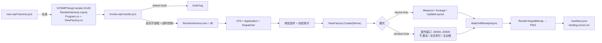

# WPF Offscreen Render

把真实的 WPF `UserControl` / `Page` / `Window` 在**独立的临时 STA 进程**里渲染成 PNG，用于检查布局、主题、尺寸、DPI、数据绑定和视觉回归。

- 不启动业务程序，不抢焦点，不弹窗口，不出现在任务栏。
- 使用真实控件、真实样式、确定的样例数据，而不是手绘 mock。
- 每次渲染附带 `manifest.json`（尺寸 / DPI / SHA256 / 绑定统计）和 `binding-errors.txt`，绑定错误直接体现在退出码上；执行器最后打印 JSON 摘要（`summary.json`），一次调用即可拿到结论。
- 常见页面免写代码：`-ViewType` / `-Xaml` + `-ResourceDictionary`（支持 `{theme}` 占位）直接渲染业务控件。
- 不依赖任何 Gallery、业务框架或特定 UI 库；支持 .NET Framework 4.7.2 / 4.8 / 4.8.1 与 .NET 5 – 10 的 WPF，只需要 .NET SDK 与 PowerShell 7。
- 仓库本身也是一个 Agent Skill（`SKILL.md`），可直接放入 `.agents/skills/` 供 Codex / Claude Code 等代理调用。

| light（layout-only，96 DPI） | dark（layout-only，96 DPI） |
| --- | --- |
|  |  |

> 以上是仓库自带样例视图的真实渲染结果，不是业务页面。

---

## 目录

- [环境要求](#环境要求)
- [快速开始](#快速开始)
- [工作原理](#工作原理)
- [仓库结构](#仓库结构)
- [脚本参数](#脚本参数)
- [渲染模式](#渲染模式)
- [输出产物](#输出产物)
- [退出码](#退出码)
- [接入真实界面](#接入真实界面)
- [尺寸与 DPI](#尺寸与-dpi)
- [视觉基线比较](#视觉基线比较)
- [已知限制](#已知限制)
- [故障排查](#故障排查)
- [测试](#测试)
- [作为 Agent Skill 使用](#作为-agent-skill-使用)
- [安全约定](#安全约定)

---

## 环境要求

| 项目 | 要求 |
| --- | --- |
| 操作系统 | Windows（WPF 仅支持 Windows；`-WindowHost` 还需要交互式桌面会话） |
| Shell | PowerShell 7+（`pwsh`），脚本带 `#requires -Version 7.0` |
| .NET SDK | 能构建目标 TFM 的 SDK，例如 .NET 8 / 9 / 10 SDK（SDK 可构建比自身版本低的 TFM，包括 .NET Framework） |
| 运行时 | .NET 宿主：与 TFM 匹配的 `Microsoft.WindowsDesktop.App`；.NET Framework 宿主：已安装对应版本的 .NET Framework（Windows 10 / 11 自带 4.8 / 4.8.1） |
| .NET Framework 引用程序集 | 已安装对应 Developer Pack，或可访问 NuGet（SDK 会自动还原 `Microsoft.NETFramework.ReferenceAssemblies`） |
| 目标程序 | .NET Framework 4.7.2 / 4.8 / 4.8.1 或 .NET 5 – 10 的 WPF；更早的 .NET Framework 程序集由 net472 宿主引用。.NET Core 3.x 不支持 |

自查命令：

```powershell
dotnet --list-sdks
dotnet --list-runtimes | Select-String WindowsDesktop
$PSVersionTable.PSVersion
```

---

## 快速开始

```powershell
git clone https://github.com/ayueryi/wpf-offscreen-render.git
cd wpf-offscreen-render

# 1. 在 %TEMP% 下生成一个独立的临时渲染工程（自带可运行样例）
#    未引用业务程序集时默认 net8.0-windows；引用后按程序集自动推断，也可显式传 -TargetFramework net48 等
$harness = & .\scripts\new-wpf-harness.ps1

# 2. 构建并渲染
$outDir = & .\scripts\invoke-wpf-render.ps1 -HarnessDir $harness.WorkDir -Theme light
if ($LASTEXITCODE -ne 0) { throw "渲染或绑定检查失败：$outDir" }

# 3. 查看结果
Get-ChildItem $outDir
Invoke-Item (Join-Path $outDir 'snapshot.png')
```

常用变体：

```powershell
# 暗色、指定视口、高 DPI，复用已构建的工程
& .\scripts\invoke-wpf-render.ps1 -HarnessDir $harness.WorkDir -Theme dark -Width 1280 -Height 800 -Dpi 144 -NoBuild

# 需要 Loaded / PresentationSource / 窗口祖先的页面
& .\scripts\invoke-wpf-render.ps1 -HarnessDir $harness.WorkDir -WindowHost -Width 1100 -Height 760
```

渲染**真实页面**：简单页面用生成器的 `-ViewType` / `-Xaml` 参数即可，复杂页面修改生成工程中的 `ViewFactory.cs`，见 [接入真实界面](#接入真实界面)。

---

## 工作原理



渲染宿主 `Program.cs` 的关键步骤：

1. 在 `[STAThread]` 主线程创建 `Application`（`ShutdownMode.OnExplicitShutdown`），所有工作在 Dispatcher 消息循环里异步执行，`await` 不会阻塞 UI 线程。
2. **绑定监听自检**：`PresentationTraceSources.DataBindingSource` 级别设为 `Warning` 并挂上自定义 `TraceListener`；随后用一个独立的 `TextBlock` 故意绑定到唯一标记路径 `WpfRenderSelfCheck_<GUID>`。只有监听器真的捕获到这条标记，才认为“绑定检查有效”。该标记之外的所有绑定告警都会被记录，不会被清空。
3. 调用 `ViewFactory.Create(theme)` 构造目标视图（**先配置资源，再构造 View**）。
4. 按模式完成布局：
   - `layout-only`：不创建窗口，直接 `Measure` / `Arrange` / `UpdateLayout`。
   - `window-host`：用 `Window` 承载（或直接使用工厂返回的 `Window`），放到屏幕外 `(-20000, -20000)`，`ShowActivated=false`、`ShowInTaskbar=false`、`WindowStyle=None`、`ResizeMode=NoResize`，然后 `Show()`，截取 `Window.Content`。
5. `await ViewFactory.WaitUntilReadyAsync(view)` 等待业务就绪信号，再跑一轮 `ContextIdle` + `UpdateLayout`。
6. `RenderTargetBitmap(ceil(W×DPI/96), ceil(H×DPI/96), DPI, DPI, Pbgra32)` 渲染并编码 PNG。
7. 写出 `manifest.json`、`binding-errors.txt`；调用 `ViewFactory.Cleanup`、关闭自己创建的窗口，然后以退出码结束进程。

执行器 `invoke-wpf-render.ps1` 只负责：构建（可跳过）→ 以独立子进程启动宿主 → 超时控制 → 收集 stdout / stderr 日志 → 回传退出码与输出目录。它**只会终止自己启动的渲染子进程**。

---

## 仓库结构

```text
wpf-offscreen-render/
├── README.md                     # 本文档
├── SKILL.md                      # Agent Skill 入口（代理工作流说明）
├── agents/
│   └── openai.yaml               # Codex 等代理的显示名与默认提示
├── assets/                       # 渲染宿主模板，生成器原样复制到临时工程
│   ├── Program.cs                # STA 宿主：绑定监听、布局、RenderTargetBitmap、manifest
│   ├── ConfiguredView.cs         # 读取 harness.json：按类型名 / 松散 XAML 创建视图、合并资源字典
│   └── ViewFactory.cs            # 需要定制时唯一要改的文件（默认先走 harness.json，再走样例）
├── scripts/
│   ├── new-wpf-harness.ps1       # 生成临时渲染工程
│   └── invoke-wpf-render.ps1     # 构建 + 渲染 + 收集产物
├── references/
│   ├── integration.md            # 接入真实界面的详细说明
│   └── verification.md           # 验收、基线比较、故障定位、性能边界
├── tests/
│   ├── run-tests.ps1             # 端到端回归测试，-Quick 可用作环境自检
│   └── fixtures/                 # 样例程序集（net472 / net8.0-windows）与松散 XAML
├── .github/workflows/ci.yml      # windows-latest 上运行 tests/run-tests.ps1
└── docs/
    └── images/                   # README 截图
```

> `assets/` 是模板，不要直接在仓库里改成某个业务页面。业务定制只发生在**生成出来的临时工程**里。

---

## 脚本参数

### `scripts/new-wpf-harness.ps1`

生成一个新的 `RenderHarness` 工程，返回 `[pscustomobject]@{ WorkDir; ProjectPath; ConfigPath; TargetFramework; Platform }`。

| 参数 | 类型 | 默认值 | 说明 |
| --- | --- | --- | --- |
| `-TargetFramework` | string | 自动 | `net472` / `net48` / `net481`，或 `net5.0-windows` … `net10.0-windows`（可带平台版本，如 `net8.0-windows10.0.19041.0`）。省略时读取 `-AssemblyPath` 的 `TargetFrameworkAttribute`：取同类中最高版本，低于 4.7.2 的 .NET Framework 程序集用 `net472`；没有业务程序集时为 `net8.0-windows`。显式指定但与业务程序集不兼容（类别不同或版本更低）时报错 |
| `-Platform` | string | 自动 | `AnyCPU` / `x86` / `x64` / `ARM64`，写入 `PlatformTarget`。省略时读取 `-AssemblyPath` 的 PE 头：存在 x86 程序集（含 C++/CLI 混合程序集与“首选 32 位”的 exe）或 x64 / ARM64 程序集就跟随它，否则 `AnyCPU`；要求冲突时报错 |
| `-WorkDir` | string | `%TEMP%\wpf-render-<GUID>` | 工程目录；**已存在则拒绝覆盖** |
| `-AssemblyPath` | string[] | 空 | 要引用的业务程序集（`.dll`，或 .NET Framework WPF 程序的 `.exe`）；以 `HintPath` + `Private=true` 写入 csproj（路径做 XML 转义，可含空格）。.NET Framework 与 .NET 程序集不能混用 |
| `-ViewType` | string | 空 | 要渲染的 View 类型（完整名或程序集限定名），需有无参构造；与 `-Xaml` 二选一 |
| `-Xaml` | string | 空 | 松散 XAML 文件（无 `x:Class` / 事件），可经 `clr-namespace;assembly=` 引用业务控件 |
| `-DataContextType` | string | 空 | 用无参构造创建并设为 View 的 `DataContext` |
| `-ResourceDictionary` | string[] | 空 | 按顺序合并的资源字典（pack URI 或绝对路径），`{theme}` 替换为 `-Theme` 的值 |

视图参数写入 `harness.json`，渲染时才读取；之后修改它或 XAML 文件只需 `-NoBuild` 重新渲染。工程同时写入空的 `Directory.Build.props` / `.targets` 与关闭集中包管理的 `Directory.Packages.props`，放在业务仓库里也不会继承上层构建配置。

生成的 csproj 关键属性：`OutputType=Exe`、`UseWPF=true`、`ImplicitUsings`、`Nullable`、`LangVersion=latest`、`PlatformTarget`。启动方式由 TFM 和位数决定：

| 宿主 | 启动方式 |
| --- | --- |
| .NET Framework | 直接运行 `out\RenderHarness.exe`，位数由 `PlatformTarget` 决定 |
| .NET，`AnyCPU` | `UseAppHost=false`，通过 `dotnet RenderHarness.dll` 启动 |
| .NET，固定 `x86` / `x64` / `ARM64` | `UseAppHost=true`，运行对应架构的 `RenderHarness.exe`，需安装该架构的 WindowsDesktop Runtime |

宿主源码只使用 .NET Framework 4.7.2 与 .NET 5+ 共有的 API（不依赖 `System.Text.Json` 等 NuGet 包），同一份 `Program.cs` / `ConfiguredView.cs` / `ViewFactory.cs` 适用于全部 TFM。定制 `ViewFactory.cs` 时同样只能用目标 TFM 存在的 API。.NET 5 / 6 / 7 已停止支持，构建时会出现 `NETSDK1138` 警告，不影响渲染。

### `scripts/invoke-wpf-render.ps1`

构建（输出到工程内 `out\`）并渲染一次，打印 JSON 摘要，输出目录路径写入管道，退出码写入 `$LASTEXITCODE`。

| 参数 | 类型 | 默认值 | 范围 | 说明 |
| --- | --- | --- | --- | --- |
| `-HarnessDir` | string | **必填** | — | `new-wpf-harness.ps1` 返回的 `WorkDir` |
| `-Width` | int | `1280` | 1–6000 | 视口宽度（DIP） |
| `-Height` | int | `800` | 1–6000 | 视口高度（DIP） |
| `-Dpi` | int | `96` | 48–384 | 输出位图 DPI，决定像素尺寸 |
| `-Theme` | string | `light` | `light` / `dark` | 仅作为字符串传给 `ViewFactory.Create`，真实主题由工厂负责应用 |
| `-WindowHost` | switch | 关 | — | 使用屏外窗口承载 |
| `-NoBuild` | switch | 关 | — | 跳过 `dotnet build`；仅在代码和引用都未变化时使用 |
| `-Background` | string | `auto` | `auto` / `transparent` / `#RRGGBB` / `#AARRGGBB` / 颜色名 | PNG 衬底。`auto`：业务窗口或被样式设置过的窗口背景优先，否则 light→白、dark→`#1E1E1E`；避免透明 PNG 在查看器中显示为黑底 |
| `-TimeoutSeconds` | int | `120` | 5–600 | 渲染子进程超时；超时会结束该子进程并写 `error.txt` |

额外保护：输出像素总数超过 6000 万（例如 6000×6000 DIP @ 192 DPI）时直接拒绝执行。

---

## 渲染模式

| 场景 | 模式 | 说明 |
| --- | --- | --- |
| 普通控件、静态布局、资源与绑定检查 | 默认 `layout-only` | 不创建 Window，显式 Measure / Arrange；**不保证**触发 `Loaded`，没有有效 `PresentationSource` |
| 依赖 `Loaded`、`PresentationSource`、`RelativeSource AncestorType=Window`、实际承载尺寸的页面；或工厂直接返回 `Window` | `-WindowHost` | 创建真实但屏外、不激活的窗口；仍需要桌面会话（服务 / 无会话的 CI 代理通常不行） |
| 页面切换卡顿、加载耗时、线程阻塞 | 另做性能诊断 | 快照只能证明某个状态下的外观，见 `references/verification.md` 的性能边界 |

`Window` 只能在 `-WindowHost` 下使用；`layout-only` 遇到 `Window` 会直接报错。窗口的 `MinWidth` / `MaxWidth` 等约束仍可能改变实际尺寸，请核对 manifest 中的 `actualWidthDip` / `actualHeightDip`。

---

## 输出产物

每次执行都会在工程目录下新建 `render-yyyyMMdd-HHmmss-<GUID>`，不会覆盖历史结果：

| 文件 | 何时生成 | 内容 |
| --- | --- | --- |
| `snapshot.png` | 渲染成功（含存在绑定错误时） | 目标视觉快照 |
| `manifest.json` | 渲染成功 | 元数据，见下表 |
| `binding-errors.txt` | 宿主正常结束 | 去重后的真实绑定告警 / 错误，每条一行；为空表示无问题（前提是自检通过） |
| `build.log` | 未使用 `-NoBuild` | `dotnet build` 完整输出 |
| `render.stdout.log` / `render.stderr.log` | 子进程启动后 | 宿主标准输出 / 错误 |
| `error.txt` | 失败时 | 异常堆栈、自检失败或超时说明 |
| `summary.json` | 总是 | 结论摘要：`status`（`ok` / `binding-issues` / `failed:build` / `failed:locate` / `failed:render`）、`snapshot`、`sourceViewType`、尺寸、衬底、前 5 条绑定问题、编译错误、异常前 15 行；同时打印到控制台 |

`manifest.json` 示例（640×260 DIP、144 DPI、window-host、dark）：

```json
{
  "generatedAt": "2026-10-10T08:03:23.6543328Z",
  "mode": "window-host",
  "sourceViewType": "System.Windows.Controls.Border",
  "theme": "dark",
  "widthDip": 640,
  "heightDip": 260,
  "pixelWidth": 960,
  "pixelHeight": 390,
  "dpi": 144,
  "actualWidthDip": 640,
  "actualHeightDip": 260,
  "background": "#FF1E1E1E",
  "backgroundSource": "theme-fallback",
  "bindingTraceVerified": true,
  "image": "snapshot.png",
  "sha256": "bafb482d…",
  "targetFramework": ".NETCoreApp,Version=v8.0",
  "runtime": ".NET 8.0.31",
  "processArchitecture": "X64",
  "machineName": "…",
  "note": "Visual snapshot; native windows, input, and performance require separate verification.",
  "bindingWarningOrErrorCount": 0,
  "exitCode": 0
}
```

| 字段 | 含义 |
| --- | --- |
| `mode` | `layout-only` 或 `window-host` |
| `sourceViewType` | 工厂返回的根类型全名，用来确认截的是真实页面而不是样例 |
| `theme` | 传入的主题**标签**；不代表业务主题已切换 |
| `widthDip` / `heightDip` | 请求的视口尺寸 |
| `pixelWidth` / `pixelHeight` / `dpi` | 实际位图尺寸与 DPI |
| `actualWidthDip` / `actualHeightDip` | 根元素布局后的实际尺寸；与请求不一致说明有约束或布局问题 |
| `bindingTraceVerified` | 绑定监听自检是否命中；`false` 时绑定统计不可信 |
| `bindingWarningOrErrorCount` | 真实绑定问题条数（排除自检标记） |
| `background` / `backgroundSource` | 实际衬底颜色与来源（`window` / `theme-fallback` / `explicit` / `transparent`）；衬底不代表业务背景 |
| `sha256` | PNG 字节哈希，用于快速判断是否完全一致 |
| `targetFramework` / `runtime` / `processArchitecture` | 宿主编译的 TFM、实际运行时（如 `.NET Framework 4.8.9221.0`）与进程架构，基线比较时应一致 |
| `exitCode` | 最终退出码 |

---

## 退出码

| 退出码 | 含义 | 是否有 PNG |
| --- | --- | --- |
| `0` | 渲染成功、绑定监听自检命中、没有真实绑定问题 | 有 |
| `1` | 构建失败 / 渲染异常 / 自检未命中 / 超时 | 通常没有；查看 `build.log`、`error.txt`、`render.stderr.log` |
| `2` | 渲染成功，但存在真实绑定告警或错误 | 有，便于排查；详情在 `binding-errors.txt` |

例：把样例绑定改成不存在的属性后，执行器返回 `2`，`binding-errors.txt` 内容为：

```text
BindingExpression path error: 'NoSuchProperty' property not found on 'object' ''SampleData' (HashCode=44115416)'. BindingExpression:Path=NoSuchProperty; DataItem='SampleData' (HashCode=44115416); target element is 'TextBlock' (Name=''); target property is 'Text' (type 'String')
```

> 退出码和 manifest 只能证明“生成成功、监听有效”。**视觉是否正确必须实际打开 PNG 看。**

---

## 接入真实界面

完整说明见 [references/integration.md](references/integration.md)，这里是最短路径。

### 1. 生成工程并引用业务程序集

```powershell
# .NET 程序：TFM 与位数按程序集自动推断（此例为 net8.0-windows）
$harness = & .\scripts\new-wpf-harness.ps1 `
    -AssemblyPath 'C:\work\MyApp\bin\Debug\net8.0-windows\MyApp.dll', `
                  'C:\work\MyApp\bin\Debug\net8.0-windows\MyUi.dll'

# .NET Framework 程序：同样自动推断（此例为 net48；x86 编译的程序集会得到 x86 宿主）
$harness = & .\scripts\new-wpf-harness.ps1 `
    -AssemblyPath 'C:\work\LegacyApp\bin\Debug\LegacyApp.exe', 'C:\work\LegacyApp\bin\Debug\LegacyUi.dll'
$harness | Select-Object TargetFramework, Platform   # 确认推断结果
```

- 路径仅为示例，先确认实际程序集名称、版本与输出位置。
- 只需要公开的 View 类型时，优先引用**已构建的 DLL**，避免触发业务项目的构建事件。需要跟随源码时，再手动在生成的 `RenderHarness.csproj` 中改用 `ProjectReference`。
- 额外的 NuGet 包、依赖 DLL、native DLL、内容文件需要手动补到生成的 csproj，并保持相对目录结构。
- Costura / 单文件发布的程序，引用普通构建产物；生产 App 的自定义程序集加载器不会在宿主中自动注册。
- 不要对生产输出目录做覆盖或全量清理。

### 2a. 免代码：类型名 / 松散 XAML

View 与 DataContext 有无参构造、资源只需按顺序合并字典、无需等待异步就绪时：

```powershell
$harness = & .\scripts\new-wpf-harness.ps1 -AssemblyPath $myUiDll `
    -ViewType MyUi.Views.OrderView -DataContextType MyUi.Preview.OrderPreviewVm `
    -ResourceDictionary '/MyUi;component/Themes/Generic.xaml', '/MyUi;component/Themes/{theme}.xaml'
& .\scripts\invoke-wpf-render.ps1 -HarnessDir $harness.WorkDir -Theme dark
```

改用 `-Xaml probe.xaml` 可渲染松散 XAML（无 `x:Class` / 事件，业务控件经 `clr-namespace:...;assembly=MyUi` 引用）。其余情况用 2b。

### 2b. 定制：修改生成工程中的 `ViewFactory.cs`

`ViewFactory` 有三个钩子，签名不要改：

```csharp
using System.Windows;
using MyUi.Views;          // 替换成真实命名空间

internal static class ViewFactory
{
    // 先配置资源，再构造 View。
    public static FrameworkElement Create(string theme)
    {
        var resources = Application.Current.Resources.MergedDictionaries;
        resources.Add(new ResourceDictionary
        {
            Source = new Uri("/MyUi;component/Themes/Generic.xaml", UriKind.Relative)
        });
        resources.Add(new ResourceDictionary
        {
            Source = new Uri(theme == "dark"
                ? "/MyUi;component/Themes/Dark.xaml"
                : "/MyUi;component/Themes/Light.xaml", UriKind.Relative)
        });

        return new OrderListPage { DataContext = PreviewViewModel.CreateSample() };
    }

    // 在布局（以及 window-host 下的 Loaded）之后、截图之前执行，运行在 Dispatcher 线程。
    public static async Task WaitUntilReadyAsync(FrameworkElement view)
    {
        var vm = (PreviewViewModel)view.DataContext;
        await vm.LoadCompleted.WaitAsync(TimeSpan.FromSeconds(15));
    }

    // 释放自己创建的订阅、计时器、Disposable VM / 图像。
    public static void Cleanup(FrameworkElement view)
    {
        (view.DataContext as IDisposable)?.Dispose();
    }
}
```

要点：

- **资源顺序**按业务项目实际加载顺序配置：Generic、字体、Converter、全局 Style、模板依赖。框架若需要 `ThemeManager` / Bootstrap，调用明确的资源初始化入口；**不要**运行生产 `App.OnStartup`、完整 IoC 启动链或主窗口。
- **主题**：`-Theme` 只是字符串，必须由工厂真正应用。对比明暗主题时，建议分两个进程分别渲染，避免静态资源和全局状态互相污染。
- **数据**：用确定的样例数据覆盖实际状态——正常、空列表、超长名称、选中项、禁用、错误提示。不依赖现场目录、相机、PLC、网络或检测引擎。控件内部会覆盖 `DataContext` 时，确认真实绑定源，不要塞匿名对象掩盖缺失。
- **副作用隔离**：检查构造函数和 `Loaded` 中是否访问硬件、网络、写文件、弹对话框或主动激活窗口；用 stub 服务 / 样例 VM 替换。不要用 `Visibility=Collapsed`、`Opacity=0`、`Hide()` 伪装离屏，它们会改变布局或呈现。

### 3. 异步就绪

- 在 `WaitUntilReadyAsync` 中 **await 明确的业务完成信号**（`Task`、`TaskCompletionSource`、事件等）。上例的 `LoadCompleted` 是示例契约，不是 WPF API。
- 不要在 UI 线程使用 `.Wait()`、`.Result`、`Thread.Sleep`——宿主依赖 Dispatcher 消息循环让加载和绑定继续推进。
- `ContextIdle` 或固定延时**不能**代替数据加载完成；固定延时只适合等待时长已知的有限动画。动画影响稳定性时，在工厂里关闭框架动画或设置静止状态。
- 需要验证选中态、展开态等，可在 `WaitUntilReadyAsync` 末尾设置，宿主随后还会再做一轮布局。

### 4. 渲染并检查

```powershell
$outDir = & .\scripts\invoke-wpf-render.ps1 -HarnessDir $harness.WorkDir -WindowHost -Width 1100 -Height 760 -Theme dark
$m = Get-Content (Join-Path $outDir 'manifest.json') -Raw | ConvertFrom-Json
$m | Select-Object mode, sourceViewType, theme, pixelWidth, pixelHeight, actualWidthDip, actualHeightDip, bindingTraceVerified, bindingWarningOrErrorCount
Get-Content (Join-Path $outDir 'binding-errors.txt')
Invoke-Item (Join-Path $outDir 'snapshot.png')
```

确认：`sourceViewType` 是真实页面；没有空白 / 全透明、裁切、文字重叠、缺失图标、主题资源失效或停在“加载中”。

---

## 尺寸与 DPI

- `-Width` / `-Height` 单位是 **DIP**（与 WPF 布局一致），默认 1280×800。
- PNG 像素 = `ceil(DIP × DPI / 96)`。例：640×360 DIP、144 DPI → 960×540 像素。
- `-Dpi` 只控制输出分辨率，**不模拟**真实多显示器 DPI 切换；依赖 `VisualTreeHelper.GetDpi` / HWND DPI 的代码需在真实显示环境另测。
- `ScrollViewer` 默认只截视口。想看完整内容，可给更大的固定高度，或在生成工程里定制截取根节点；固定高度只用于视觉检查。
- 虚拟化列表中未实例化的项不会因截图出现。可以用小规模数据，或**仅在临时宿主里**关闭虚拟化 / 分页；不要为截图修改业务行为。

---

## 视觉基线比较

前后比较必须保持一致：机器、字体、资源版本、样例数据、视口、主题、DPI、动画状态。

```powershell
$before = Get-Content (Join-Path $baselineDir 'manifest.json') -Raw | ConvertFrom-Json
$after  = Get-Content (Join-Path $outDir 'manifest.json') -Raw | ConvertFrom-Json
[pscustomobject]@{
    SameHash    = $before.sha256 -eq $after.sha256
    BeforeImage = Join-Path $baselineDir 'snapshot.png'
    AfterImage  = Join-Path $outDir 'snapshot.png'
}
```

- SHA256 相等 ⇒ PNG 字节完全相同；不相等 ≠ 回归，需要并排看图并结合修改目的判断。
- 字体渲染、系统更新、显卡驱动都可能带来像素差异，不要用一个全局阈值代替人工判断。
- 基线保存在你选定的稳定目录；生成新基线前保留旧基线，**不要自动覆盖**已认可的基线。临时产物不要提交进业务仓库。

---

## 已知限制

| 限制 | 原因 / 替代方案 |
| --- | --- |
| `Popup`、`ToolTip`、`ContextMenu` 不出现在快照里 | 它们在独立的呈现源（独立 HWND）中；需在定制宿主中对其 `Child` 单独渲染 |
| `HwndHost`、`WindowsFormsHost`、WebView、HALCON 等 native 视口为空白 | WPF / HWND airspace 限制，`RenderTargetBitmap` 不捕获 native 内容；使用组件自身的图像导出接口，或获授权后做实际窗口捕获。**不要把 native 空白判定为回归** |
| 不含系统窗口边框和阴影 | 只截 `Window.Content`；业务自绘标题栏属于内容，会被截到 |
| 不能证明性能 | `RenderTargetBitmap` 成功不代表页面切换不卡；性能需单独计时，见 `references/verification.md` |
| 不能证明交互 | 快照不覆盖输入、焦点、键盘导航 |
| `-WindowHost` 需要桌面会话 | 无交互会话的服务或 CI 代理可能失败 |
| .NET Core 3.x 程序 | 只支持 .NET Framework 4.7.2+ 与 .NET 5+ 宿主；3.x 程序集需升级，或显式 `-TargetFramework net5.0-windows` 等后自行验证兼容性 |
| 混用 .NET Framework 与 .NET 程序集 | 一个进程只能承载一种运行时，生成器会拒绝；分别生成宿主 |
| WinUI / UWP | 本工具针对 WPF 的 `System.Windows.Media.Imaging.RenderTargetBitmap`，与 WinUI / UWP 同名 API 无关 |

---

## 故障排查

| 现象 | 优先检查 |
| --- | --- |
| `找不到类型`（harness.json 模式） | 类型名是否含完整命名空间、程序集是否在 `-AssemblyPath` 中 |
| 编译缺类型、加载程序集失败 | TFM、DLL / NuGet 版本、运行时依赖与内容文件；看 `build.log` / `error.txt` |
| `ResourceReferenceKeyNotFoundException` / `XamlParseException` | 资源合并顺序、pack URI、Theme bootstrap；看内层异常 |
| 空白图或 `actual*Dip` 为 0 | Measure / Arrange、Visibility、返回的根元素；是否依赖 `Loaded`（改用 `-WindowHost`） |
| 样式正确但数据缺失 | 实际 `DataContext`、`Binding.Path`、异步完成信号；看 `binding-errors.txt` |
| `bindingTraceVerified=false` | `PresentationTraceSources.Refresh`、监听注册时机；**不要把空日志当成没有绑定错误** |
| 截图停在“加载中” | `WaitUntilReadyAsync` 是否在等真实任务，而不是 `ContextIdle` |
| 窗口出现在屏幕上 / 弹出对话框 | 构造函数或 `Loaded` 的自身行为；停止本次验证并隔离副作用 |
| 原生视口或菜单缺失 | 见[已知限制](#已知限制) |
| 多次输出不稳定 | 主题静态状态、动画、当前时间、随机数据、字体、异步未就绪 |
| 构建输出被锁定 | 使用独立 harness / 临时输出；不要擅自结束正在运行的业务程序 |
| 超时（`error.txt` 提示超过 N 秒） | 就绪信号永不完成、UI 线程被同步阻塞；必要时调大 `-TimeoutSeconds` 定位 |

更多验收与性能边界说明见 [references/verification.md](references/verification.md)。

---

## 测试

`tests/run-tests.ps1` 会构建 `tests/fixtures` 中的样例程序集，逐个生成宿主并渲染，断言退出码、`summary.json` 与 `manifest.json`：

```powershell
.\tests\run-tests.ps1                    # 全部用例（每个用例都会新建并构建宿主，耗时较长）
.\tests\run-tests.ps1 -Quick             # 内置样例 + 松散 XAML，用作环境自检
.\tests\run-tests.ps1 -Filter 'net472*'  # 按名称筛选；-KeepArtifacts 保留产物
```

| 覆盖范围 | 用例 |
| --- | --- |
| 渲染模式、主题、DPI、衬底 | `sample-light`、`sample-dark-dpi144`、`sample-window-host`、`sample-transparent` |
| 免代码接入 | `xaml-ok`、`net8-view`、`net472-view` |
| 绑定错误检出（退出码 2） | `xaml-binding-error`、`net8-broken-binding`、`net472-broken-binding` |
| TFM / 位数推断 | `net472-view`（AnyCPU → 64 位）、`net472-x86-view`（x86）、`sample-net10` |
| 生成器拒绝不兼容组合 | `reject-mixed-runtimes`、`reject-lower-tfm`、`reject-platform-conflict` |

需要 .NET 8 与 .NET 10 SDK（`sample-net10` 用例）以及 .NET Framework 4.7.2+ 运行时。通过时删除产物目录，失败时保留并打印路径。

---

## 作为 Agent Skill 使用

仓库根目录即 Skill 目录（`SKILL.md` + `agents/` + `assets/` + `scripts/` + `references/` + `tests/`）。不同代理从不同目录发现 Skill：

| 代理 | 项目级（随仓库共享） | 用户级（本机所有项目） |
| --- | --- | --- |
| Claude Code | `<工作区>\.claude\skills\wpf-offscreen-render` | `%USERPROFILE%\.claude\skills\wpf-offscreen-render` |
| Codex 等读取 `.agents` 的代理 | `<工作区>\.agents\skills\wpf-offscreen-render` | 以对应代理的文档为准 |

```powershell
$skills = 'C:\path\to\workspace\.claude\skills'   # 或 .agents\skills、$env:USERPROFILE\.claude\skills
New-Item -ItemType Directory -Path $skills -Force | Out-Null

# 方式一：复制
robocopy . "$skills\wpf-offscreen-render" /E /XD .git .github docs

# 方式二：目录联接，保持与本仓库同步
New-Item -ItemType Junction -Path "$skills\wpf-offscreen-render" -Target (Get-Location).Path

# 安装后自检
& "$skills\wpf-offscreen-render\tests\run-tests.ps1" -Quick
```

`SKILL.md` 的 `description` 决定代理何时加载此 Skill；修改触发场景时改这一行。

代理会在用户提到“WPF 离屏截图、RenderTargetBitmap、无焦点界面预览、修改 WPF 后验证视觉效果”时加载 `SKILL.md`，按其中流程生成临时工程、渲染、查看 PNG 并报告：真实页面 / 样例、模式、尺寸与 DPI、主题、绑定检查、视觉结论、未覆盖内容和产物绝对路径。

修改 Skill 行为时同步更新 `SKILL.md`、`references/` 和本 README，并运行 `tests/run-tests.ps1`（CI 在 `windows-latest` 上对每次推送运行同一脚本）。

---

## 安全约定

- 生成器拒绝覆盖已存在目录；执行器每次新建输出目录。
- 执行器只对**自己启动的**渲染子进程施加超时与终止，不会结束其他程序。
- 宿主只关闭自己创建或承载的窗口；`Cleanup` 只释放样例自己创建的对象。
- 本工具不授予启动生产程序、连接设备、访问现场数据或执行 Git 操作的权限；这些行为应在接入时用样例 / stub 隔离。
- 临时工程和产物默认位于 `%TEMP%`，不写入业务仓库。

## 参考

- [RenderTargetBitmap（WPF）](https://learn.microsoft.com/en-us/dotnet/api/system.windows.media.imaging.rendertargetbitmap)
- [WPF Threading Model](https://learn.microsoft.com/en-us/dotnet/desktop/wpf/advanced/threading-model)
- [WPF Layout](https://learn.microsoft.com/en-us/dotnet/desktop/wpf/advanced/layout)
- [Technology Regions Overview（airspace）](https://learn.microsoft.com/en-us/dotnet/desktop/wpf/advanced/technology-regions-overview)
