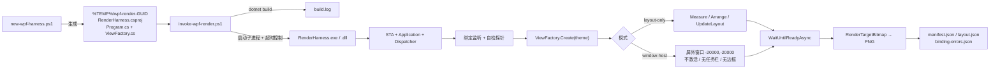

# WPF Offscreen Render

把真实的 WPF `UserControl` / `Page` / `Window` 在**独立的临时 STA 进程**里渲染成 PNG，用于检查布局、主题、尺寸、DPI、数据绑定和视觉回归。

- 不启动业务程序，不抢焦点，不弹窗口，不出现在任务栏。
- 使用真实控件、真实样式、确定的样例数据，而不是手绘 mock。
- 每次渲染附带 `manifest.json`（尺寸 / DPI / SHA256 / 绑定统计）、逐条解析的绑定错误和布局检查结果（文本截断、被裁切、重叠、尺寸为 0、超出视口）；绑定错误直接体现在退出码上，执行器最后打印 JSON 摘要（`summary.json`），一次调用即可拿到结论。
- 常见页面免写代码：`-ViewType` / `-Xaml` + `-ResourceDictionary`（支持 `{theme}` 占位）直接渲染业务控件。
- 不依赖任何 Gallery、业务框架或特定 UI 库；支持 .NET Framework 4.7.2 / 4.8 / 4.8.1 与 .NET 5 – 10 的 WPF，只需要 .NET SDK 与 PowerShell 7。
- 仓库本身也是一个 Agent Skill（`SKILL.md`），可直接放入 `.agents/skills/` 供 Codex / Claude Code 等代理调用。

| light（layout-only，96 DPI） | dark（layout-only，96 DPI） |
| --- | --- |
|  |  |

> 以上是仓库自带样例视图的真实渲染结果，不是业务页面。

---

## 目录

- [环境要求](#环境要求)
- [快速开始](#快速开始)
- [工作原理](#工作原理)
- [仓库结构](#仓库结构)
- [文档导航](#文档导航)
- [测试](#测试)
- [作为 Agent Skill 使用](#作为-agent-skill-使用)
- [安全约定](#安全约定)

---

## 环境要求

| 项目 | 要求 |
| --- | --- |
| 操作系统 | Windows（WPF 仅支持 Windows；`-WindowHost` 还需要交互式桌面会话） |
| Shell | PowerShell 7+（`pwsh`），脚本带 `#requires -Version 7.0` |
| .NET SDK | 能构建目标 TFM 的 SDK，例如 .NET 8 / 9 / 10 SDK（SDK 可构建比自身版本低的 TFM，包括 .NET Framework） |
| 运行时 | .NET 宿主：与 TFM 匹配的 `Microsoft.WindowsDesktop.App`；.NET Framework 宿主：已安装对应版本的 .NET Framework（Windows 10 / 11 自带 4.8 / 4.8.1） |
| .NET Framework 引用程序集 | 已安装对应 Developer Pack，或可访问 NuGet（SDK 会自动还原 `Microsoft.NETFramework.ReferenceAssemblies`） |
| 目标程序 | .NET Framework 4.7.2 / 4.8 / 4.8.1 或 .NET 5 – 10 的 WPF；更早的 .NET Framework 程序集由 net472 宿主引用。.NET Core 3.x 不支持 |

自查命令：

```powershell
dotnet --list-sdks
dotnet --list-runtimes | Select-String WindowsDesktop
$PSVersionTable.PSVersion
```

---

## 快速开始

```powershell
git clone https://github.com/ayueryi/wpf-offscreen-render.git
cd wpf-offscreen-render

# 1. 一步渲染内置样例（生成或复用缓存宿主 → 构建 → 渲染 → 打印 JSON 摘要）
$outDir = & .\scripts\render.ps1 -Theme light
if ($LASTEXITCODE -ne 0) { throw "渲染或绑定检查失败：$outDir" }

# 2. 渲染真实页面：TFM 与位数按程序集自动推断；同一组程序集第二次起跳过构建
$outDir = & .\scripts\render.ps1 -AssemblyPath 'C:\work\MyApp\bin\Debug\net8.0-windows\MyUi.dll' `
    -ViewType MyUi.Views.OrderView -DataContextType MyUi.Preview.OrderPreviewVm -Theme dark -Dpi 144

# 3. 查看结果
Get-Content (Join-Path $outDir 'summary.json')
Invoke-Item (Join-Path $outDir 'snapshot.png')

# 一次渲染多个组合（只构建一次），返回含 matrix.json 与 overview.png 总览图的目录
$matrixDir = & .\scripts\render.ps1 -AssemblyPath $myUiDll -ViewType MyUi.Views.OrderView -Theme light, dark -Size 1280x800, 800x600

# 另存某个 x:Name 元素的截图（element.png）
& .\scripts\render.ps1 -AssemblyPath $myUiDll -ViewType MyUi.Views.OrderView -Element OrderGrid

# 修改前后对比：差异图（变化像素标红）、变化占比与变化区域
& .\scripts\compare-snapshots.ps1 -Before $baselineDir -After $outDir
```

需要定制视图创建过程（构造参数、stub 服务、等待异步就绪）时改用两步：

```powershell
$harness = & .\scripts\new-wpf-harness.ps1 -AssemblyPath $myUiDll   # 生成工程，之后修改其中的 ViewFactory.cs
& .\scripts\invoke-wpf-render.ps1 -HarnessDir $harness.WorkDir -Theme dark -Width 1280 -Height 800
& .\scripts\invoke-wpf-render.ps1 -HarnessDir $harness.WorkDir -WindowHost -NoBuild   # 代码未变时跳过构建
```

详见 [references/integration.md](references/integration.md)。

---

## 工作原理



渲染宿主 `Program.cs` 的关键步骤：

1. 在 `[STAThread]` 主线程创建 `Application`（`ShutdownMode.OnExplicitShutdown`），所有工作在 Dispatcher 消息循环里异步执行，`await` 不会阻塞 UI 线程。
2. **绑定监听自检**：`PresentationTraceSources.DataBindingSource` 级别设为 `Warning` 并挂上自定义 `TraceListener`；随后用一个独立的 `TextBlock` 故意绑定到唯一标记路径 `WpfRenderSelfCheck_<GUID>`。只有监听器真的捕获到这条标记，才认为“绑定检查有效”。该标记之外的所有绑定告警都会被记录，不会被清空。
3. 调用 `ViewFactory.Create(theme)` 构造目标视图（**先配置资源，再构造 View**）。
4. 按模式完成布局：
   - `layout-only`：不创建窗口，直接 `Measure` / `Arrange` / `UpdateLayout`。
   - `window-host`：用 `Window` 承载（或直接使用工厂返回的 `Window`），放到屏幕外 `(-20000, -20000)`，`ShowActivated=false`、`ShowInTaskbar=false`、`WindowStyle=None`、`ResizeMode=NoResize`，然后 `Show()`，截取 `Window.Content`。
5. `await ViewFactory.WaitUntilReadyAsync(view)` 等待业务就绪信号，再跑一轮 `ContextIdle` + `UpdateLayout`。
6. `RenderTargetBitmap(ceil(W×DPI/96), ceil(H×DPI/96), DPI, DPI, Pbgra32)` 渲染并编码 PNG。
7. 遍历视觉树写出 `layout.json`（元素坐标与布局问题），写出 `manifest.json`、`binding-errors.txt` / `.json`；调用 `ViewFactory.Cleanup`、关闭自己创建的窗口，然后以退出码结束进程。

执行器 `invoke-wpf-render.ps1` 只负责：构建（可跳过）→ 以独立子进程启动宿主 → 超时控制 → 收集 stdout / stderr 日志 → 回传退出码与输出目录。它**只会终止自己启动的渲染子进程**。

---

## 仓库结构

```text
wpf-offscreen-render/
├── README.md                     # 本文档
├── SKILL.md                      # Agent Skill 入口（代理工作流说明）
├── agents/
│   └── openai.yaml               # Codex 等代理的显示名与默认提示
├── assets/                       # 渲染宿主模板，生成器原样复制到临时工程
│   ├── Program.cs                # STA 宿主：绑定监听、布局、RenderTargetBitmap、manifest
│   ├── ConfiguredView.cs         # 读取 harness.json：按类型名 / 松散 XAML 创建视图、合并资源字典
│   ├── Diagnostics.cs            # 绑定错误解析与布局检查（layout.json）
│   ├── Json.cs                   # 不依赖 NuGet 的 JSON 写入器（兼容 .NET Framework）
│   └── ViewFactory.cs            # 需要定制时唯一要改的文件（默认先走 harness.json，再走样例）
├── scripts/
│   ├── new-wpf-harness.ps1       # 生成临时渲染工程
│   ├── invoke-wpf-render.ps1     # 构建 + 渲染 + 收集产物
│   ├── render.ps1                # 一步渲染：缓存宿主、多组合渲染与总览图
│   ├── compare-snapshots.ps1     # 前后对比：差异图、变化占比与变化区域
│   └── ImageTools.cs / .ps1      # 差异图与总览图（PowerShell 内编译，依赖 System.Drawing）
├── references/
│   ├── cli.md                    # 脚本参数、输出文件与字段、退出码
│   ├── integration.md            # 接入真实界面的详细说明
│   └── verification.md           # 验收、基线比较、故障定位、性能边界
├── tests/
│   ├── run-tests.ps1             # 端到端回归测试，-Quick 可用作环境自检
│   └── fixtures/                 # 样例程序集（net472 / net8.0-windows）与松散 XAML
├── .github/workflows/ci.yml      # windows-latest 上运行 tests/run-tests.ps1
└── docs/
    └── images/                   # README 截图
```

> `assets/` 是模板，不要直接在仓库里改成某个业务页面。业务定制只发生在**生成出来的临时工程**里。

---

## 文档导航

| 文档 | 内容 |
| --- | --- |
| [SKILL.md](SKILL.md) | 代理工作流：何时用、怎么调用、如何读摘要与报告 |
| [references/cli.md](references/cli.md) | 全部脚本参数、渲染模式、输出文件与字段、退出码、尺寸与 DPI |
| [references/integration.md](references/integration.md) | 接入真实界面：程序集与 TFM 推断、`harness.json`、定制 `ViewFactory.cs`、资源与主题、异步就绪、截图范围 |
| [references/verification.md](references/verification.md) | 产物验收、布局检查解读、视觉基线比较、故障定位、已知限制、性能验证边界 |

接入真实界面的最短路径：View 与 DataContext 有无参构造、资源只需按顺序合并字典时，直接用 `render.ps1 -AssemblyPath … -ViewType …`（见上方快速开始）；需要构造参数、stub 服务、等待异步就绪时，用 `new-wpf-harness.ps1` 生成工程并修改其中的 `ViewFactory.cs`，详见 [integration.md](references/integration.md)。

**已知限制**（完整列表见 [verification.md](references/verification.md#已知限制)）：`Popup` / `ToolTip` / `ContextMenu` 与 `HwndHost`、`WindowsFormsHost`、WebView 等原生内容不在快照内；快照不证明性能与交互；`-WindowHost` 需要桌面会话；不适用于 WinUI / UWP。

---

## 测试

`tests/run-tests.ps1` 会构建 `tests/fixtures` 中的样例程序集，逐个生成宿主并渲染，断言退出码、`summary.json` 与 `manifest.json`：

```powershell
.\tests\run-tests.ps1                    # 全部用例（每个用例都会新建并构建宿主，耗时较长）
.\tests\run-tests.ps1 -Quick             # 内置样例 + 松散 XAML，用作环境自检
.\tests\run-tests.ps1 -Filter 'net472*'  # 按名称筛选；-KeepArtifacts 保留产物
```

| 覆盖范围 | 用例 |
| --- | --- |
| 渲染模式、主题、DPI、衬底 | `sample-light`、`sample-dark-dpi144`、`sample-window-host`、`sample-transparent` |
| 免代码接入 | `xaml-ok`、`net8-view`、`net472-view` |
| 绑定错误检出（退出码 2）与解析 | `xaml-binding-error`、`net8-broken-binding`、`net472-broken-binding` |
| 布局检查：五类问题全部检出、正常布局零误报 | `net8-layout-problems`、`net472-layout-problems`、`net8-scroll-no-false-positive`，以及正常视图的 `layoutIssueCount = 0` |
| 一步脚本缓存：首次构建、再次跳过、程序集变化后重建 | `render-cache` |
| 多组合渲染、总览图、只构建一次 | `render-matrix` |
| 截取指定元素、元素不存在时报错并列出可用名称 | `net8-element`、`net8-element-missing` |
| 前后对比：相同判定、主题变化判为不同并报告环境差异 | `compare-snapshots` |
| TFM / 位数推断 | `net472-view`（AnyCPU → 64 位）、`net472-x86-view`（x86）、`sample-net10` |
| 生成器拒绝不兼容组合 | `reject-mixed-runtimes`、`reject-lower-tfm`、`reject-platform-conflict` |

需要 .NET 8 与 .NET 10 SDK（`sample-net10` 用例）以及 .NET Framework 4.7.2+ 运行时。通过时删除产物目录，失败时保留并打印路径。

---

## 作为 Agent Skill 使用

仓库根目录即 Skill 目录（`SKILL.md` + `agents/` + `assets/` + `scripts/` + `references/` + `tests/`）。不同代理从不同目录发现 Skill：

| 代理 | 项目级（随仓库共享） | 用户级（本机所有项目） |
| --- | --- | --- |
| Claude Code | `<工作区>\.claude\skills\wpf-offscreen-render` | `%USERPROFILE%\.claude\skills\wpf-offscreen-render` |
| Codex 等读取 `.agents` 的代理 | `<工作区>\.agents\skills\wpf-offscreen-render` | 以对应代理的文档为准 |

```powershell
$skills = 'C:\path\to\workspace\.claude\skills'   # 或 .agents\skills、$env:USERPROFILE\.claude\skills
New-Item -ItemType Directory -Path $skills -Force | Out-Null

# 方式一：复制
robocopy . "$skills\wpf-offscreen-render" /E /XD .git .github docs

# 方式二：目录联接，保持与本仓库同步
New-Item -ItemType Junction -Path "$skills\wpf-offscreen-render" -Target (Get-Location).Path

# 安装后自检
& "$skills\wpf-offscreen-render\tests\run-tests.ps1" -Quick
```

`SKILL.md` 的 `description` 决定代理何时加载此 Skill；修改触发场景时改这一行。

代理会在用户提到“WPF 离屏截图、RenderTargetBitmap、无焦点界面预览、修改 WPF 后验证视觉效果”时加载 `SKILL.md`，按其中流程生成临时工程、渲染、查看 PNG 并报告：真实页面 / 样例、模式、尺寸与 DPI、主题、绑定检查、视觉结论、未覆盖内容和产物绝对路径。

修改 Skill 行为时同步更新 `SKILL.md`、`references/` 和本 README，并运行 `tests/run-tests.ps1`（CI 在 `windows-latest` 上对每次推送运行同一脚本）。

---

## 安全约定

- 生成器拒绝覆盖已存在目录；执行器每次新建输出目录。
- 执行器只对**自己启动的**渲染子进程施加超时与终止，不会结束其他程序。
- 宿主只关闭自己创建或承载的窗口；`Cleanup` 只释放样例自己创建的对象。
- 本工具不授予启动生产程序、连接设备、访问现场数据或执行 Git 操作的权限；这些行为应在接入时用样例 / stub 隔离。
- 临时工程和产物默认位于 `%TEMP%`，不写入业务仓库。

## 参考

- [RenderTargetBitmap（WPF）](https://learn.microsoft.com/en-us/dotnet/api/system.windows.media.imaging.rendertargetbitmap)
- [WPF Threading Model](https://learn.microsoft.com/en-us/dotnet/desktop/wpf/advanced/threading-model)
- [WPF Layout](https://learn.microsoft.com/en-us/dotnet/desktop/wpf/advanced/layout)
- [Technology Regions Overview（airspace）](https://learn.microsoft.com/en-us/dotnet/desktop/wpf/advanced/technology-regions-overview)
